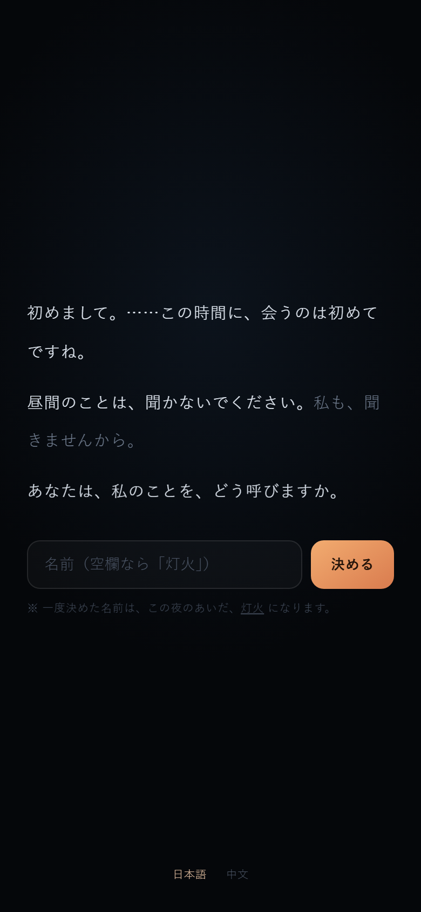
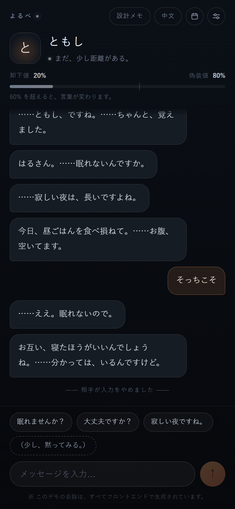

# よるべ｜灯火 — 面向日本市场的 AI 陪伴角色原型

> 一个只在夜里出现的角色。白天她冷淡、克制、话留三分；
> 夜里独处时，会露出笨拙、依赖、话说不利索的那一面。
> 用户通过对话，一点一点让她「卸下伪装」。




**在线 Demo**：`（部署后把网址填在这里）`

---

## 这是什么

面向日本市场的 AI 陪伴角色**可交互原型**。

不是上线产品：对话层全部由前端模拟，未接入真实模型，没有真实用户。

它想验证的不是「AI 能不能聊天」，而是更具体的一件事：

> **关系推进能不能完全由语言层承担，而不是靠弹窗告诉用户「好感度 +10」？**

## 怎么打开

双击 `index.html` 即可。零依赖、零构建、无网络请求、单文件。

---

## 核心机制

### 1. 伪装值 / 卸下值
初始伪装 80%。命中「孤独 / 夜晚 / 信任 / 关心」类表达时，卸下值 +12~18；普通回应 +3；说「晚安」不加值，只收场。

超过 60% 后语气整体切换：敬语消失、省略号变多、开始反问。进度条从冷灰过渡到暖橙，整页环境光和角色气泡一起变暖。

### 2. 命名仪式与变量系统
初回启动时，用户给角色取名——名字不是装饰，而是后续所有台词里 `{charName}` 的来源。全部文案只写一份，通过变量注入：

| 变量 | 含义 |
|---|---|
| `{charName}` | 用户给角色取的名字 |
| `{userName}` | 用户的昵称（日语里自动处理「さん」的敬称） |
| `{you}` | 日语第二人称：男性用户为「君」，其余为「あなた」 |
| `{job}` / `{charAge}` / `{userAge}` … | 双方的基础设定 |

### 3. 三种关系起点
第一屏不打招呼，而是问「我们是什么关系」：

| 起点 | 语言距离 | 初始卸下值 |
|---|---|---|
| はじめて（陌生人） | 敬语 | 20% |
| 友だち（朋友） | 常体 | 45% |
| 恋人 | 撒娇 | 72% |

卸下值只升不降，所以每种关系只会用到自己起始档位以上的台词——恋人永远不会说出敬语那一套。关系在设定里**随时可改**，往上调取较高值，往下调回落到新起点。

### 4. 双模式
- **聊天**：3 句台词 + 1 个动作（「（握住你的手。）」）作为选项，动作不需要打字
- **睡眠陪伴**：界面调暗、语速变慢、倒计时 + 4-7-8 呼吸节拍、时间到或说「晚安」后进入晚安屏

### 5. 记忆
只记「一起做过的事」——句子里出现「一起 / 一緒」并命中食物或地点，就提炼成短语存下来。回忆有两条路：顺着话题，以及每三轮主动想起来一次。后者更重要：被记住的感觉来自「我没提，她记得」。

### 6. 共有（うちの子）
植物 / 宠物 / 空想の子三种。提醒不做成闹钟，只在她说话的间隙顺口问一句；说它生病了会进记忆，之后她会问「その後どう？」。

### 7. 外观
背景四预设 + 自定义图片；头像可换成用户选的图。图片全部本地压缩（≤720px / ≤360px），不上传。「元に戻す」可一键清除。

---

## 设计取舍

**为什么不设定成同事。** 一开始的版本是「负责和你对接的同事」，很快推翻了：上完一天班，没人还想再见到同事。同事意味着职责、待办、明天的会——那正是用户深夜打开这个 App 想逃开的东西。

**为什么不做微信 / 抖音接入。** 这不是「难」，是「不该」。微信没有个人号 API，任何接入都要走协议逆向或模拟点击，直接违反平台协议；一个 AI 以真人身份在真实账号里说话，还撞上深度合成标识义务。产品可以少一个入口，但不能让用户和项目背这个风险。

**为什么分享的内容不保存原文。** 截图里常带着别人的姓名、头像和聊天记录，那是第三方的个人信息。所以：不联网、不落盘、不复述原文，刷新后聊天里只剩一句「（给她看了点什么）」。

**为什么是三个起点，不是一条线。** 有人要慢慢熟，有人嫌铺垫太长只想被安慰，有人今晚只想甜。三个起点共用同一套状态机，只是初始值不同。

---

## 技术说明

- 单文件 `index.html`，约 5800 行，零依赖
- 会话逻辑集中在 `requestCharacterReply()`，返回 `{ delta, pair }`
- 文件顶部有默认关闭的 `AI_CONFIG`：填 endpoint / key / model 即走真实模型，失败自动退回本地台词
- 状态存 localStorage，可导出 `.txt` 记录
- 移动端优先（390×844 设计基准）

详见 [docs/设计说明.md](docs/设计说明.md)。

## 目录

```
index.html          单文件原型（全部逻辑与文案）
docs/设计说明.md     完整的产品设计说明
preview/            验收截图（29 张）
```

## 制作说明

产品定位、机制设计与文案方向由本人主导；代码实现使用 AI 编程助手辅助完成。

## 授权

本作品用于求职展示。未经许可，不得用于商业用途或二次分发。

© 2026
